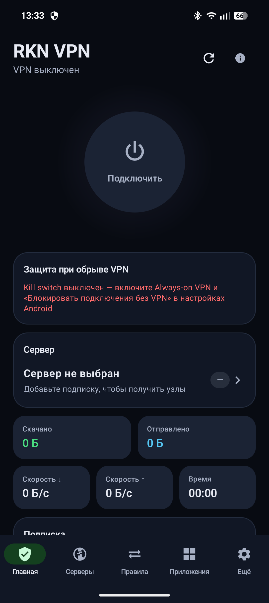
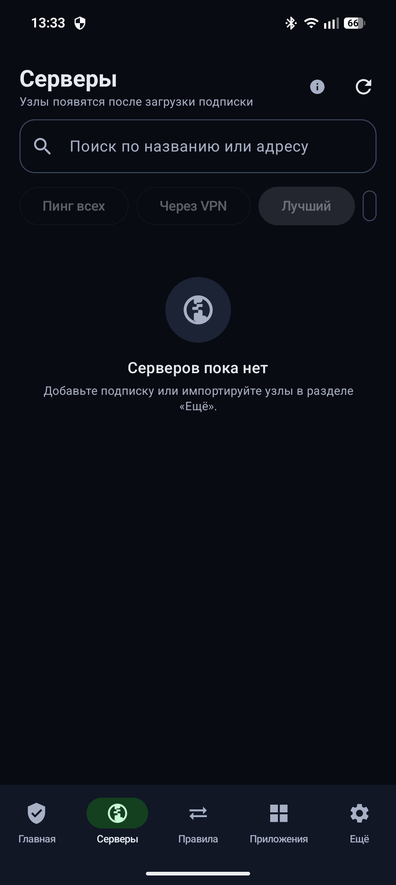
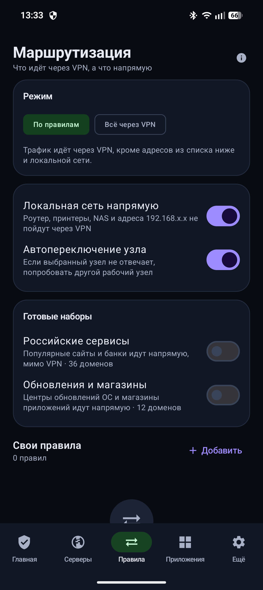
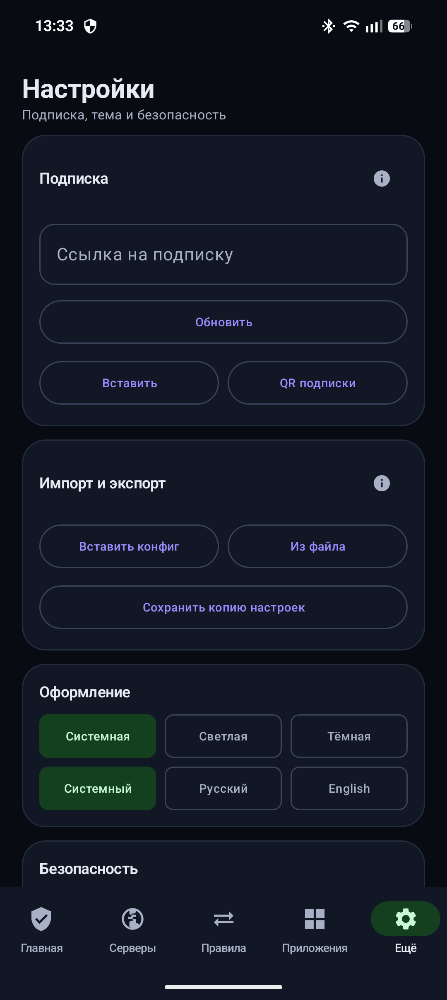

# RKN VPN

**Автор:** leo0797 · [English README](README_EN.md)

Android VPN-клиент на ядре mihomo (Clash.Meta): VLESS + XHTTP + Reality,
Hysteria2, TUIC, AnyTLS, Shadowsocks, Trojan, VMess и WireGuard. Подписки
Remnawave и 3x-ui, статистика, маршрутизация и плитка в быстрых настройках.

> Приложение не содержит серверов. Для работы нужна ваша подписка или импортированные узлы.

## Скриншоты

| Главный экран | Серверы |
|---|---|
|  |  |
|  |  |

## Возможности

- Подключение одной кнопкой, уведомление с кнопкой «Отключить».
- Плитка в шторке: тап — включить/выключить, долгий тап — открыть приложение.
- Подписка по ссылке: узлы, трафик и срок действия (`subscription-userinfo`,
  `profile-title`, `profile-update-interval`), HWID-заголовки Remnawave.
- Добавление подписки на главном экране: вставить из буфера или отсканировать QR.
- Deep links: `vless://`, `vmess://`, `trojan://`, `ss://`, `hysteria2://`,
  `hy2://`, `tuic://`, `anytls://`, `wireguard://`, `clash://install-config`,
  `happ://add` и `rknvpn://add?url=...`.
- Универсальный импорт: Clash/Mihomo YAML, SIP008 JSON, base64 и plain-списки
  share-ссылок; вставка текста, загрузка файла или сканирование QR-кода.
- Трафик, скорость, время сессии, TCP-пинг и выбор узла «Лучший».
- Проверка узлов через локальный API mihomo — реальное соединение, работает
  и с UDP-протоколами (Hysteria2, TUIC).
- Автопереподключение после потери сети и выхода из спящего режима.
- Раздельное туннелирование: только выбранные приложения **или** всё через VPN,
  кроме выбранных. Правила для доменов и подсетей, пресеты `ru_direct`.
- Статус системного kill switch (Always-on VPN + блокировка без VPN) на главном
  экране и подсказка, как отключить оптимизацию батареи на Xiaomi/Huawei/Samsung.
- Резервная копия настроек в файл. HWID, токен подписки и пароли узлов в неё не входят.
- Проверка обновлений через GitHub Releases с проверкой SHA-256 и подписи APK.
- Тёмная/светлая/системная тема, русский и английский интерфейс, Material 3.
- Язык следует системной локали, но его можно переопределить в «Оформлении».
- Кнопки «?» с пояснениями сложных настроек.

## Где взять подписку

Приложение не продаёт доступ и не содержит встроенных серверов. Подписку выдаёт
ваш провайдер VPN: это ссылка вида `https://panel.example.com/sub/XXXX` из панели
Remnawave, 3x-ui или совместимой панели. Если вы не знаете свою ссылку — напишите
администратору вашего сервера. Не используйте случайные публичные ссылки из чатов:
в них можно подменить узлы или перехватить ваш трафик.

Специальные шаблоны и префиксы не нужны — достаточно обычной HTTP(S)-ссылки на
подписку. Формат `clash://install-config?url=...` и share-ссылки узлов тоже
поддерживаются.

## Поддерживаемые ссылки и форматы

| Что | Пример | Как использовать |
|---|---|---|
| Подписка Remnawave / 3x-ui | `https://panel.example.com/sub/...` | Поле «Ссылка на подписку», буфер, QR или deep link |
| Share-ссылки | `vless://`, `vmess://`, `trojan://`, `ss://`, `hysteria2://`, `hy2://`, `tuic://`, `anytls://`, `wireguard://`, `wg://` | По одной или списком, в том числе base64 |
| Clash / Mihomo YAML | секция `proxies:` | «Вставить» или «Из файла» |
| SIP008 JSON | `{"servers":[...]}` | «Вставить» или «Из файла» |

Ссылка на подписку принимается только `http`/`https` (редиректы тоже
проверяются: переход `https → http` запрещён). Резервная копия — JSON приложения,
не конфиг прокси.

## Установка и обновление

### Вручную

1. Скачайте APK для своей архитектуры со страницы
   [Releases](https://github.com/leo0797/RKN-VPN/releases): `app-arm64-v8a-release.apk`
   (большинство телефонов) или `app-armeabi-v7a-release.apk` (старые устройства).
2. Откройте RKN VPN → «Ещё» → вставьте ссылку на подписку и нажмите
   «Сохранить и обновить». Также можно импортировать YAML/JSON/share-ссылки
   кнопкой «Вставить» или отсканировать QR-код.
3. На главном экране нажмите «Подключить» и разрешите Android создать VPN.
4. В шторке: «Изменить» → перетащите плитку **RKN VPN**. Тап переключает VPN,
   долгий тап открывает приложение.

**С 1.0.22 сертификат подписи новый.** Если у вас установлена старая версия,
удалите её перед установкой. Это одноразово: после этого обновления будут
устанавливаться поверх через приложение.

### Obtainium

1. Установите [Obtainium](https://github.com/ImranR98/Obtainium).
2. Добавьте приложение → **GitHub (Release)**.
3. URL репозитория: `https://github.com/leo0797/RKN-VPN`.
4. В «Дополнительных настройках» → «Фильтр версий/ассетов» укажите имя нужного
   APK: `app-arm64-v8a-release.apk` или `app-armeabi-v7a-release.apk`.
5. package name: `app.rkn.vpn`. После обновления Obtainium сам скачает APK.

Обновление через само приложение тоже работает: оно сверяет SHA-256 из описания
релиза и подпись APK, скачивает файл только с `github.com` и запускает установку.

## Безопасность и ограничения

- SOCKS5 и API mihomo слушают только `127.0.0.1`; прокси защищён паролем, API — secret.
- Токен подписки и секреты узлов шифруются через Android Keystore; диагностика
  не содержит ссылку на подписку, HWID и пароли.
- DNS ядра использует DoH; системные DNS-запросы отвечает hev mapdns, IPv6 тоже
  завёрнут в туннель.
- Приложение не логирует ключи и не отправляет их никуда, кроме вашего сервера.
- APK скачивается только с GitHub и проверяется по SHA-256 из релиза и по
  подписи, совпадающей с текущей версией приложения.

Чего нельзя гарантировать без root:

- **Kill switch.** Надёжно блокирует трафик только системная настройка
  **Always-on VPN** + «Блокировать подключения без VPN». Текущий статус показан
  на главном экране; кнопка в «Настройках» открывает эти параметры.
- **Скрытие факта VPN.** Другие приложения видят активный VPN-интерфейс.
- **Скрытие точки выхода.** Сайты видят IP сервера. Reality/XHTTP снижают
  вероятность детекта, но не дают гарантии.

## Лицензия

[GPL-3.0](LICENSE), так как используется [mihomo](https://github.com/MetaCubeX/mihomo).
`hev-socks5-tunnel` распространяется по MIT.
