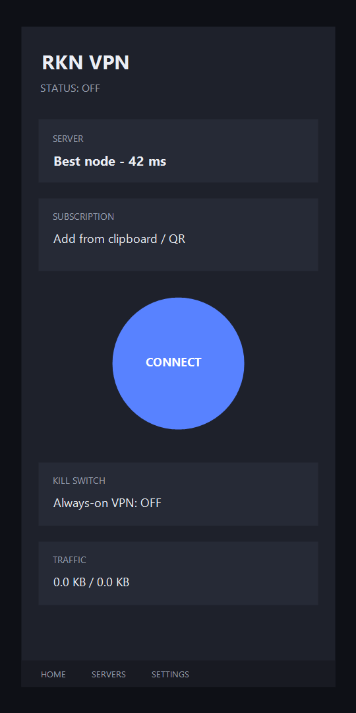
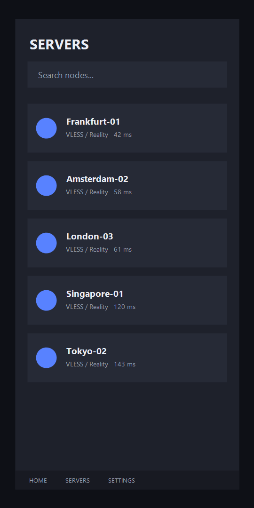

# RKN VPN

**Author:** leo0797 · [Русская версия](README.md)

An Android VPN client built on the mihomo (Clash.Meta) core: VLESS + XHTTP +
Reality, Hysteria2, TUIC, AnyTLS, Shadowsocks, Trojan, VMess and WireGuard.
Supports Remnawave and 3x-ui subscriptions, traffic stats, routing and a
Quick Settings tile.

> The app ships no servers. You need your own subscription or imported nodes.

## Screenshots

| Home | Servers and rules |
|---|---|
|  |  |

## Features

- One-tap connect and a notification with a Disconnect action.
- Quick Settings tile: tap to toggle, long tap to open the app.
- Subscription links: nodes, traffic and expiry (`subscription-userinfo`,
  `profile-title`, `profile-update-interval`), Remnawave HWID headers.
- Add a subscription from Home: paste from the clipboard or scan a QR code.
- Deep links: `vless://`, `vmess://`, `trojan://`, `ss://`, `hysteria2://`,
  `hy2://`, `tuic://`, `anytls://`, `wireguard://`, `clash://install-config`,
  `happ://add` and `rknvpn://add?url=...`.
- Universal import: Clash/Mihomo YAML, SIP008 JSON, base64 and plain share-link
  lists; paste text, load a file or scan a QR code.
- Traffic, speed, session time, TCP ping and a "Best node" action.
- Node checks through the local mihomo API — a real connection test that also
  works with UDP protocols (Hysteria2, TUIC).
- Automatic reconnect after network loss and after device sleep.
- Split tunneling: only selected apps **or** everything except selected apps.
  Domain/subnet rules and the `ru_direct` preset.
- System kill switch status (Always-on VPN + block connections without VPN) on
  Home, plus a battery-optimization hint for Xiaomi/Huawei/Samsung.
- Encrypted settings backup file. HWID, subscription token and node passwords
  are not included.
- GitHub Releases update checks with SHA-256 and APK signature verification.
- Dark/light/system themes, Russian and English UI, Material 3.
- Language follows the system locale but can be overridden in Appearance.
- "?" buttons explain non-obvious settings.

## Where to get a subscription

The app does not sell access and contains no built-in servers. Your VPN provider
issues the subscription: it is a link like `https://panel.example.com/sub/XXXX`
from a Remnawave, 3x-ui or compatible panel. If you do not know your link, ask
the administrator of your server. Do not use random public links from chats —
they can replace nodes or intercept your traffic.

No special prefixes are needed — a normal HTTP(S) subscription URL is enough.
`clash://install-config?url=...` and node share links are supported too.

## Supported links and formats

| What | Example | How to use |
|---|---|---|
| Remnawave / 3x-ui subscription | `https://panel.example.com/sub/...` | Subscription field, clipboard, QR or deep link |
| Share links | `vless://`, `vmess://`, `trojan://`, `ss://`, `hysteria2://`, `hy2://`, `tuic://`, `anytls://`, `wireguard://`, `wg://` | One by one or as a list, including base64 |
| Clash / Mihomo YAML | `proxies:` section | Paste or load from file |
| SIP008 JSON | `{"servers":[...]}` | Paste or load from file |

Only `http`/`https` subscription links are accepted. Redirects are checked too:
`https → http` is blocked. The backup is the app's own JSON, not a proxy config.

## Install and update

### Manually

1. Download an APK for your architecture from
   [Releases](https://github.com/leo0797/RKN-VPN/releases):
   `app-arm64-v8a-release.apk` (most phones) or `app-armeabi-v7a-release.apk`
   (older devices).
2. Open RKN VPN → More → paste the subscription link and tap Save and refresh.
   You can also import YAML/JSON/share links with Paste or scan a QR code.
3. On Home tap Connect and allow Android to create a VPN.
4. In the shade: Edit → drag the **RKN VPN** tile. Tap toggles the VPN, long tap
   opens the app.

**Since 1.0.22 the signing certificate has changed.** If you have an older
version installed, uninstall it first. This is a one-time step; after that,
in-app updates will install over the current version.

### Obtainium

1. Install [Obtainium](https://github.com/ImranR98/Obtainium).
2. Add app → **GitHub (Release)**.
3. Repository URL: `https://github.com/leo0797/RKN-VPN`.
4. In Additional settings → Asset filter, enter the exact APK name:
   `app-arm64-v8a-release.apk` or `app-armeabi-v7a-release.apk`.
5. Package name: `app.rkn.vpn`. Obtainium will download the APK on update.

In-app updates work too: they verify the SHA-256 from the release notes and the
APK signature, download only from `github.com`, and start the installer.

## Security and limitations

- SOCKS5 and the mihomo API listen only on `127.0.0.1`; the proxy has a password
  and the API has a secret.
- The subscription token and node secrets are encrypted with Android Keystore.
  Diagnostics never include the subscription link, HWID or passwords.
- Core DNS uses DoH; system DNS queries are answered by hev mapdns, and IPv6 is
  routed through the tunnel.
- The app does not log keys and does not send them anywhere except your server.
- APKs are downloaded only from GitHub and verified against the release SHA-256
  and the signature of the installed app.

What cannot be guaranteed without root:

- **Kill switch.** Only the system settings **Always-on VPN** plus "Block
  connections without VPN" reliably block leaks. The current status is shown on
  Home; a button in Settings opens these options.
- **Hiding the VPN.** Other apps can see an active VPN interface.
- **Hiding the exit point.** Websites see your server's IP. Reality/XHTTP reduce
  the chance of detection but cannot guarantee it.

## License

[GPL-3.0](LICENSE) because of [mihomo](https://github.com/MetaCubeX/mihomo).
`hev-socks5-tunnel` is distributed under MIT.
